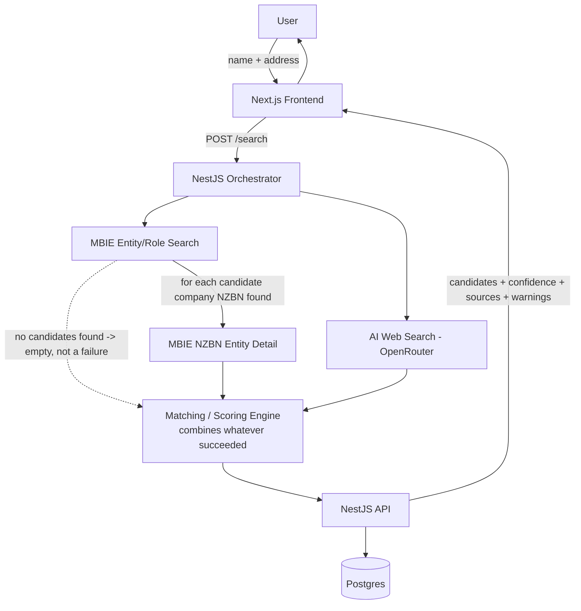

# Implementation Plan — Property Owner Contact Finder

> Scope target: ~2 hours of focused build time. This plan optimizes for a working,
> explainable end-to-end flow over completeness. Every shortcut is called out
> explicitly so it can be revisited later.

## 1. Goal (restated)

Given a **property owner's name** + **property address** (selected via Google
Places Autocomplete), find and display any public **contact details** (email,
phone, other identifiers) for that person, each with:
- a **confidence score**
- a **source**
- a short **reasoning trail** explaining the match

Enrichment must cross-reference **MBIE Companies Register** and **MBIE
Entity/Role Search** to see if the owner appears as a director/shareholder of
a company, and whether any registered/company address matches the property
address (a strong corroborating signal).

## 2. Architecture



**Why this shape:** every source is always queried — there is no confidence-based
gating of which calls happen. The only conditional step is a genuine *data*
dependency, not a decision: NZBN entity detail can't be looked up until Entity/Role
Search has returned a candidate company's NZBN, so it necessarily runs after that
call, for every candidate found (if none are found, that branch is simply empty,
not skipped-on-purpose). AI web search and Entity/Role Search both only need the
original name + address, so they run in parallel with no dependency between them.

Each of the three call types (Entity/Role Search, NZBN detail per candidate, AI
web search) is executed independently (`Promise.allSettled` + a per-call timeout),
so a failure or timeout in any one is captured as "source unavailable" rather than
aborting the whole search — see section 5 for the resilience contract. The
matching/scoring engine is a *deterministic, explainable* layer that sits between
raw data sources and the response: it always runs on whatever evidence did come
back, and the response carries a `warnings[]` field naming any source that failed
or returned nothing. The LLM is used where it adds value (web-style search &
unstructured extraction, and plain-English reasoning) but never as the sole
arbiter of confidence — confidence is computed from explicit signals so it can be
justified in conversation, not just "vibes".

## 3. Tech stack & rationale

| Layer | Choice | Why |
|---|---|---|
| Frontend | Next.js (App Router, TypeScript) | Required. Server actions/route handlers keep the Google Places key server-side where possible. |
| Backend | NestJS (TypeScript) | Required. Modular structure (modules per concern) maps cleanly to: `search`, `mbie`, `ai`, `matching`, `contacts`. |
| DB | PostgreSQL (native local install) + Prisma | Required. Used to cache MBIE lookups and persist past searches/results so re-running a search is fast and auditable. |
| AI | OpenRouter | Required. See model choice below. |
| Address autocomplete | Google Places Autocomplete (New) / Places Autocomplete widget | Specified in brief. Returns structured address components (street number, route, suburb, city, postcode) which we reuse for address-matching logic, not just display. |

### Model choice (OpenRouter)

Two-model strategy (both callable through the same OpenRouter key):

1. **`perplexity/sonar`** (or `sonar-pro` if budget allows) — has built-in live
   web search with citations. This is the "AI searches for contact details"
   engine: it can plausibly find personal websites, real-estate agent bios,
   news mentions, LinkedIn snippets, Yellow/White Pages listings, etc., and
   — critically — **returns the URLs it used**, which becomes the `source`
   field directly. This avoids hand-rolling a scraper in the time budget.
2. **`openai/gpt-4o-mini`** (cheap, fast, good at structured output) — used for:
   - normalising/parsing whatever Sonar returns into strict JSON
     (`{name, email, phone, other, sourceUrl, quote}`)
   - producing the plain-English "why this looks like a match" explanation
     for the matching engine's output.

Rationale documented for the README: an "online" model solves the "go find
things on the internet" requirement without building a bespoke search/scrape
pipeline; a small structured-output model keeps the schema strict enough for
the UI to render reliably. If `perplexity/sonar` isn't available/behaves
oddly, fallback is `gpt-4o-mini` + a manual web search call (e.g. Serper/Bing) —
flagged as a trade-off, not built unless time allows.

## 4. "Think outside the box" sources

In priority order, cheapest/most reliable first:

1. **MBIE Companies Register** — company name, registered/postal address,
   NZBN, status.
2. **MBIE Entity/Role Search** — links a person name to companies via role
   (director, shareholder, etc.), including other companies they're
   associated with (useful when the property address matches a *different*
   company's registered address than expected — still a corroborating signal).
3. **NZ Yellow Pages / White Pages** (`yellow.co.nz`, `whitepages.co.nz`) —
   public residential/business phone listings. Queried via the Sonar model's
   web search rather than a bespoke scraper (ToS/time constraints — noted as
   a shortcut).
4. **Company websites** discovered via (1)/(2) — "Contact Us" / "Our Team"
   pages often list director emails/phones directly; Sonar can be prompted to
   check the company's own domain if one is inferable from its name.
5. **General web search fallback** (news mentions, real-estate agency staff
   pages, LinkedIn public profile snippets) via Sonar.

Each hit is tagged with a `sourceType` enum (`MBIE_COMPANIES_REGISTER`,
`MBIE_ENTITY_ROLE`, `YELLOW_PAGES`, `COMPANY_WEBSITE`, `WEB_SEARCH`, `OTHER`)
so the UI can show a recognisable icon/label per source.

## 5. MBIE API integration

> Endpoints below were confirmed working via direct `curl` testing against both
> provided keys, so this section reflects the real API contract rather than a
> guess. Both APIs authenticate via an `Ocp-Apim-Subscription-Key` header against
> `https://api.business.govt.nz/gateway/...`.

- `MbieModule` in NestJS, with two clients:
  - `EntityRoleClient.searchPersonRoles(name)` → calls
    `GET /gateway/companies-office/companies-register/entity-roles/v3/search?name={name}&page=1&page-size=10&registered-only=true&role-type=ALL`,
    normalised to `RoleRecord { firstName, lastName, roleType, status,
    associatedCompanyName, associatedCompanyNzbn, associatedCompanyStatusCode,
    appointmentDate, resignationDate, physicalAddress }`.
  - `NzbnClient.getEntity(nzbn)` → calls `GET /gateway/nzbn/v5/entities/{nzbn}`
    (the "Companies Register" key is actually provisioned against the **NZBN API**,
    not the separate "Companies v2" incorporation API — that one is for
    reserving/administering companies you own and returned 401 for this key; its
    own docs point to the NZBN API for search/read access). Returns the richest
    single source of truth: `addresses.addressList` (REGISTERED / SERVICE /
    SHAREREGISTER types), `company-details.shareholding` (current + historic
    shareholders with names and addresses), and top-level `roles[]` (directors
    with status ACTIVE/INACTIVE and addresses).
  - Both clients: API key from env, sent via `Ocp-Apim-Subscription-Key` header,
    thin retry/backoff, response caching in Postgres (`mbie_cache` table keyed by
    request signature + TTL) so repeated demo runs don't hit rate limits.
- **Call sequencing (no gating, resilient to partial failure):** `EntityRoleClient.searchPersonRoles`
  and the AI web search both fire immediately in parallel (neither depends on the
  other). Once role search returns, `NzbnClient.getEntity` is called for **every**
  candidate NZBN found — this always happens, it is a data dependency, not a
  confidence-gated decision. All calls are wrapped individually (try/catch +
  timeout, aggregated with `Promise.allSettled`, not `Promise.all`) so that a
  failure or timeout in any single call (e.g. AI search times out, or one MBIE
  endpoint 500s) does not discard results that already succeeded from the other
  sources. The matching engine always scores off whatever evidence is available,
  and the API response includes a `warnings[]` array listing any source that
  failed or returned nothing, so partial results are visible rather than silently
  dropped or surfaced as a hard error.

## 6. Matching & confidence engine (the core "how do you reason about it" piece)

Deterministic scoring so it's explainable on demand — not left to the LLM.

**Inputs per candidate (MBIE role record, contact-detail hit, etc.):**
- Name similarity: normalise (case, remove middle names/initials, strip
  titles), then score via **Jaro-Winkler** (good for name variants/typos) —
  weight 0–40 points.
- Address similarity: compare Google's structured components (street number,
  route, suburb/city, postcode) against the MBIE registered/postal address
  components, not raw strings — weight 0–40 points. Exact street number+route
  match = full marks; suburb/city-only match = partial.
- Corroboration bonus: if **both** an MBIE role and a web/Yellow-Pages contact
  hit point to the same name+company, add up to 20 points.
- Recency/status: a `ceased` directorship or `removed` company status slightly
  discounts the score (signal is stale).
- **Missing source ≠ zero/failed match:** if Entity/Role Search, NZBN detail, or
  AI web search failed or returned nothing (see section 5's resilience contract),
  the engine simply scores off the remaining evidence — it does not treat a
  failed call the same as "checked and found no match". The response's
  `warnings[]` array is what tells the user/reviewer a source didn't respond,
  so a low score is never confused with an unavailable source.

**Score → label mapping** (documented, not hidden):
- 80–100 → **High confidence**
- 50–79 → **Medium confidence**
- 20–49 → **Low confidence**
- 0–19 → **filtered out** (not shown, or shown under "other possible matches"
  if nothing else qualifies)

**Multiple candidates:** if 2+ names clear the "shown" threshold (e.g. two
different John Smiths), the UI shows them as **separate candidate cards**
ranked by score, each with its own evidence — no silent merging.

**No results:** explicit empty state distinguishing "we found the person but
no contact details" vs "we couldn't even find the person in MBIE/web data" —
these imply different next steps for the user.

The LLM's job here is narrow: given the computed score + evidence bullet
points, phrase a one-sentence human-readable rationale ("Matches on exact
name + registered address at 12 Queen St, corroborated by a Yellow Pages
listing under the same name"). The score itself is never LLM-generated.

## 7. Data model (Postgres)

```
search_request(id, owner_name, address_raw, address_components jsonb, created_at)
mbie_cache(id, request_signature, endpoint, response jsonb, fetched_at, expires_at)
candidate(id, search_request_id, matched_name, confidence_score, confidence_label,
          rationale, created_at)
contact_detail(id, candidate_id, type[email|phone|other], value, source_type,
               source_url, confidence_score)
```

Kept intentionally flat/simple — no auth, no multi-tenant concerns, since this
runs locally for a demo. Prisma migrations checked into the repo.

## 8. Backend structure (NestJS)

```
src/
  search/            # controller + orchestration service (the "search" use case)
  mbie/              # NzbnClient, EntityRoleClient, adapter interfaces
  ai/                # OpenRouterService (chat + sonar web search), prompt templates
  matching/          # scoring engine (pure functions, unit-testable)
  contacts/          # persistence (Prisma repositories)
  common/            # config, validation pipes, DTOs
```

`POST /search { ownerName, address }` → orchestrates MBIE calls + AI search in
parallel → runs matching engine → persists → returns
`{ candidates: [{ name, confidenceScore, confidenceLabel, rationale, contacts: [{type, value, sourceType, sourceUrl}] }] }`.

## 9. Frontend structure (Next.js)

```
app/
  page.tsx                 # search form: name input + Google Places autocomplete
  results/page.tsx (or client component on same page)  # results list
components/
  AddressAutocompleteInput.tsx
  CandidateCard.tsx         # name, confidence badge, rationale, contact list
  ConfidenceBadge.tsx       # colour-coded High/Medium/Low
  ContactRow.tsx            # icon per type + source link
  EmptyState.tsx            # no-match / no-contacts states
```

Single-page flow: form → loading state (calls can take a few seconds due to
AI web search) → results. Keep it to one screen given the time budget.

## 10. Security & config

- All API keys (OpenRouter, both MBIE keys, Google Places) in `.env`
  (backend) / `.env.local` (frontend, if the Places key must be exposed to
  the browser widget — prefer a server-side proxy endpoint for autocomplete
  if time allows, to avoid shipping the key client-side).
- `.env*` gitignored; `.env.example` committed with empty placeholders.
- Input validation via NestJS `class-validator` DTOs (reject empty/absurdly
  long names/addresses).
- Basic rate limiting on `/search` (NestJS throttler) since it fans out to
  paid AI + external APIs.
- No PII beyond what's already public is stored beyond the local demo DB;
  README will note this is a prototype, not production-hardened for real PII
  handling.

## 11. Time-boxed build order (~2 hrs)

1. **(15m)** Scaffold: Next.js app, NestJS app, native local PostgreSQL install,
   Prisma schema + migration, env files.
2. **(20m)** MBIE clients: read docs, implement both clients against real
   endpoints, quick manual curl/test.
3. **(20m)** OpenRouter service: sonar web-search call + gpt-4o-mini
   structured extraction; prompt templates.
4. **(20m)** Matching engine: pure scoring functions + unit tests for a
   couple of scenarios (exact match, partial address, no match).
5. **(20m)** `/search` orchestration endpoint wiring it all together +
   persistence.
6. **(20m)** Frontend: form with Places autocomplete, results UI, loading/
   empty states.
7. **(15m)** README (run instructions, model choice, trade-offs) + push to
   private GitHub repo.

## 12. Known shortcuts to flag in the README

- No scraping of Yellow/White Pages directly — delegated to the Sonar
  model's web search, which is faster to build but less controllable/
  reproducible than a dedicated scraper.
- No auth/multi-user support — single local user, demo-only.
- MBIE response caching is time-boxed/naive (simple TTL), not a full sync.
- Name-matching is Jaro-Winkler based; doesn't handle nicknames (e.g.
  "Bill" vs "William") — would add a nickname-alias table with more time.
- Minimal automated test coverage — unit tests on the scoring engine only,
  given the time budget; no e2e tests.
- Confidence thresholds (80/50/20) are reasonable starting points, not
  empirically tuned.

## 13. README (final deliverable) will cover

- How to run locally (native local PostgreSQL install, env setup, `npm run dev`
  for both apps).
- Model choice explanation (section 3 above, condensed).
- Architecture summary + the matching/confidence explanation (section 6),
  since the reviewer explicitly wants to hear this reasoning explained.
- Trade-offs/shortcuts list (section 12).
